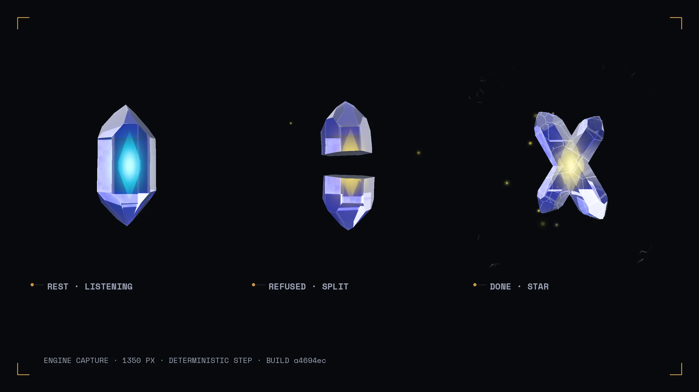
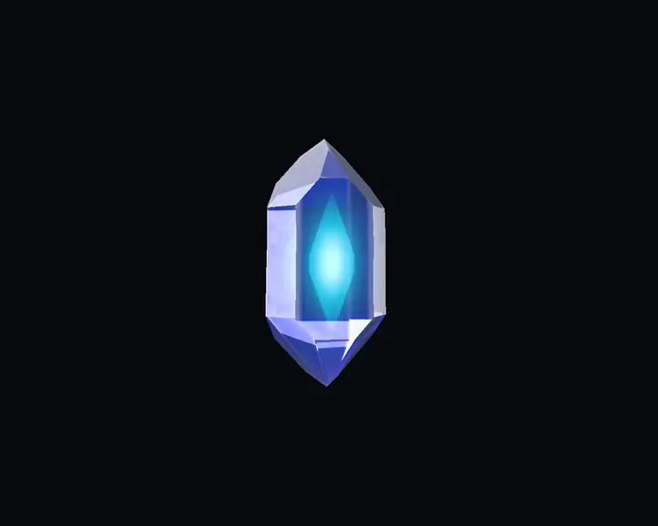
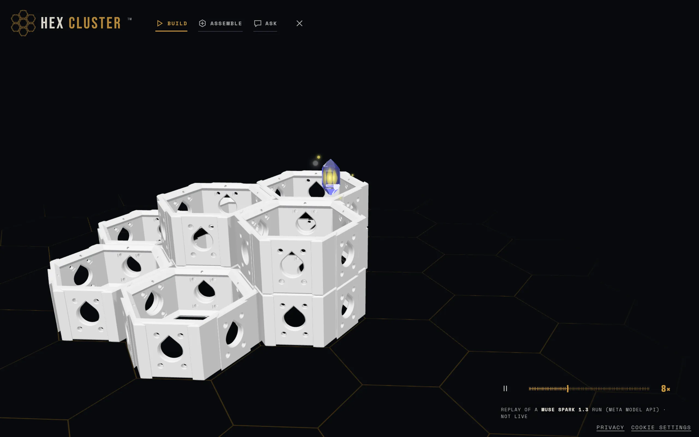

<p align="center">
  
</p>
<p align="center"><sub>Frames from the built file's own renderer, stepped deterministically at 1350 px on the deep-space field (<code>harness/capture-readme.mjs</code>), November 2026 · 121 KB gzip</sub></p>

# emotive-hex-agent

The Hex Cluster agent's crystal: an extreme-lean build of the Emotive Engine, one gem that shows what the build agent is doing.

**Live** · [hex.onethousanddrones.com](https://hex.onethousanddrones.com) (open the agent; `?replays` plays recorded runs) · **Docs** · [docs/](docs/) · **Status** · active

## What it does

A small gem crystal floats over the build in the [Hex Cluster configurator](https://hex.onethousanddrones.com), windowless, and shows what the build agent is doing: listening, thinking, placing parts, being refused, finishing. It flies to each part, shows the part's ghost and places it, changes its core colour with its emotion, splits on a refusal (shock and a slow ruby shift) and becomes a star on a finished build. The host app owns the agent's state table, timing and copy; this engine exposes the primitives (emotion, undertone, gesture, gem colour, morph, particles).

<p align="center">
  
</p>
<p align="center"><sub>The example below, as the engine renders it: 12 s at 15 fps from <code>harness/capture-readme.mjs</code>, every frame a pure function of its index, November 2026</sub></p>

## Build and use

Needs Node 20 or later and Google Chrome (the browser gates and captures use the system Chrome through Playwright). The package is not on npm; the host application vendors the built file.

```sh
npm install
npm run build        # dist/emotive-hex-agent.js, ESM, three left external
npm test             # 276 unit tests in 27 files, jsdom, no browser
npm run size         # 476 KB raw, 121 KB gzip, 100 KB brotli; ceiling 150 KB gzip
```

Mount the gem in a page that maps `three` (0.170) in an import map, point it at the agent assets, and drive it:

```js
import { EmotiveMascot3D } from './dist/emotive-hex-agent.js';

const gem = new EmotiveMascot3D({ assetBasePath: '/agent', coreGeometry: 'hexgem', surface: 'dark' });
gem.init(document.getElementById('stage'));
gem.setSurface('dark');
await gem.start();
await gem.whenVisible();                       // shaders link off the main thread; nothing draws before this

gem.setEmotion('focused', 'confident');        // the core colour follows the emotion
gem.express('shock');                          // a refusal: the electric moment
gem.morphTo('split', { duration: 600 });       // and the gem splits
gem.morphTo('hexgem', { duration: 600 });      // whole again
gem.setEmotion('joy');
gem.express('electricflourish');               // a finished build
gem.morphTo('star-cross', { duration: 700 });  // becomes the star
```

That sequence is the loop above. Shapes: `hexgem`, `twisted`, `trio`, `cluster`, `split`, `rosette` and the victory star `star-cross`. Gestures kept: `breathe`, `sway`, `float`, `lean`, `tilt`, `nod`, `shake`, `bounce`, `pulse`, `expand`, `contract`, `wave`, `peek`, `point` and its four directions, `spin`, `orbit`, `sparkle`, `shimmer`, `flash`, `glow`, plus `shock` and `electricflourish` for the two electric moments. The assets (seven crystal shapes, the soul inclusion, five electric meshes in three sets, one detail map) are in [`test/fixtures/agent/`](test/fixtures/agent/) with their generators and hashes in [`PROVENANCE.json`](test/fixtures/agent/PROVENANCE.json); the host serves its own copy.

<p align="center">
  
</p>
<p align="center"><sub>The crystal in the live configurator, replaying a recorded run of the <a href="https://github.com/Otd-llc/hex-agent">hex-agent</a> (hex.onethousanddrones.com/?replays, November 2026)</sub></p>

## Notable engineering

- **Every frame is a pure function of its index.** A test-only stepping hook (`__step`) and a seeded RNG replace the clocks, so the gates measure the same frames on every machine and the captures above come out identical run to run. [`harness/agent.html`](harness/agent.html), [`harness/capture-readme.mjs`](harness/capture-readme.mjs)
- **The refusal cannot flash.** The flash gate renders the shock, ruby shift and shift back at 1/120, 1/60 and 1/30 s on both fields and measures the central window against WCAG 2.3.1; the emotion colour swap is eased over a minimum time, and the gate fails when the flash-safety caps are switched off (`--plant-stock-flicker`). [`harness/gates/flash.mjs`](harness/gates/flash.mjs), [`harness/flash-metric.mjs`](harness/flash-metric.mjs)
- **A dark gem that still moves fails.** The states gate drives every shape, star and emotion and requires the gem's luminance delta against the field to stay above a floor on both surfaces, so no colour or morph may lose the gem. [`harness/gates/states.mjs`](harness/gates/states.mjs)
- **Fifty open-close cycles leak nothing.** The teardown gate closes the gem mid-shader-link fifty times and requires every GL context lost, zero GL calls after teardown and zero engine timers pending. [`harness/gates/teardown.mjs`](harness/gates/teardown.mjs)
- **Size is a gate, not a hope.** `npm run size` measures the built file against a 150 KB gzip ceiling; the stripped build is 121 KB. [`scripts/size.mjs`](scripts/size.mjs)

Each browser gate takes a `--plant-*` flag that injects the fault it guards against and must then fail: `npm run gate:gl`, `gate:teardown`, `gate:states`, `gate:flash`.

## What it keeps and what it drops

Kept: the 3D crystal path, the crystal shader and its inner light, the gem colour presets, the particles (restyled), the electric element for two moments only (`shock` on a refusal, `electricflourish` on a finished build), a short list of everyday motions, and morphing between purpose-made Blender geometries.

Dropped: the 2D engine, music, rhythm, BPM, dance and groove systems, every other element, the moon/sun/eclipse geometry, orbit controls, the profiler, shatter and cracks, screen-space bloom, motion blur, ambient occlusion, the HDRI path, and every stock asset. The engine loads only the Blender-made agent assets; a copy lives under `test/fixtures/agent/`, hashed against its `sha256.json` (the source of truth is the host app's `public/agent/`).

## API

Type declarations are in [`types/`](types/) (`index.d.ts` for the mascot, its config and events; `3d.d.ts` for the 3D core). The public surface of the built file is `EmotiveMascot3D` (also the default export) and `SSSPresets`, from [`src/3d/index-hex-agent.js`](src/3d/index-hex-agent.js).

## Support

Browsers with WebGL 2 (without it `init()` logs a warning and renders nothing). Peer dependency `three ~0.170.0`, resolved by the host. Node 20 or later to build and test.

## Contributing

Issues and pull requests on GitHub. Anything not specific to this build belongs upstream in [joshtol/emotive-engine](https://github.com/joshtol/emotive-engine).

## Where it came from

Derived from the Emotive Engine, Copyright (c) 2025-2026 Joshua Tollette, MIT. Source taken at engine commit `56e0bcaf` (branch `fix/site-audit-2026-10-22`, dated 2026-10-23, before the event) and imported without history on 2026-11-02 as this repository's first commit, `5c14213`. Everything after that commit is new work by One Thousand Drones LLC, built during the Meta Global AI Dev Hackathon (2026-10-27 to 2026-11-04). See `NOTICE`. The [hex-agent](https://github.com/Otd-llc/hex-agent) entered for judging does not import this repository; the hosted configurator serves it.

## License

MIT (`MIT`), Copyright (c) 2025-2026 Joshua Tollette and Copyright (c) 2026 One Thousand Drones LLC. See [LICENSE.md](LICENSE.md), [NOTICE](NOTICE) and [docs/THIRD-PARTY-LICENSES.md](docs/THIRD-PARTY-LICENSES.md).

---

<sub><b>ONE THOUSAND DRONES</b> · [onethousanddrones.com](https://onethousanddrones.com) · [academy.onethousanddrones.com](https://academy.onethousanddrones.com) · [github.com/Otd-llc](https://github.com/Otd-llc)</sub>
<!-- otd-readme-kit footer v1 -->
